# 🔐 Security Toolkit

[](https://github.com/PH-Vidal/security-toolkit/actions/workflows/ci-devsecops.yml)

-brightgreen)


CLI modular em Python (zero dependências externas em runtime) voltada para **DevSecOps, Blue Team / Análise de Logs (MITRE ATT&CK), Auditoria Web/TLS (OWASP) e Reconhecimento de Rede Autorizado**.

---

## Arquitetura & Pipeline DevSecOps

```mermaid
flowchart LR
    CLI["sec-toolkit CLI (argparse + JSON/Report)"]
    CLI --> M1["log-analyze\nBlue Team / MITRE ATT&CK"]
    CLI --> M2["http-audit\nOWASP Headers & TLS"]
    CLI --> M3["ports / ping\nConcurrent Net Recon"]
    CLI --> M4["hash / password\nIntegrity & NIST 800-63B"]

    subgraph DevSecOps["GitHub Actions DevSecOps Pipeline"]
        direction TB
        S1["Ruff Lint + Bandit SAST"] --> S2["Pytest + Coverage (3.11/3.12)"]
        S2 --> S3["Trivy FS (Secrets / Misconfig / Vulns)"]
        S3 --> S4["Hardened Docker Build + Trivy Image Scan"]
        S4 --> S5["Sanitized Discord Alert"]
    end
```



---

## Módulos Disponíveis

| Comando | Foco | O que faz |
| :--- | :--- | :--- |
| `log-analyze` | **Blue Team / SOC** | Analisa logs `auth.log` (SSH) e Nginx/Apache detectando Brute Force, comprometimento pós-brute force, SQLi, Path Traversal, XSS e varredura de diretórios — mapeado para **MITRE ATT&CK**. |
| `http-audit` | **AppSec / Web** | Audita headers HTTP de segurança (HSTS, CSP, XFO, XCTO, Referrer-Policy, Permissions-Policy), exposição de stack (`Server`/`X-Powered-By`) e validade/protocolo do certificado **TLS**. |
| `ports` | **Network Recon** | Scanner TCP concorrente (`ThreadPoolExecutor`) com suporte a intervalos de portas (`22,80,8000-8010`), detecção de serviços comuns e *banner grabbing* opcional. |
| `ping` | **Network Recon** | Descoberta ICMP concorrente multiplataforma (Windows/Linux) com validação estrita de CIDR via `ipaddress` (prevenção contra *argument injection*). |
| `hash` | **DFIR / Integridade** | Gera hashes MD5, SHA-256 e SHA-512 de textos ou arquivos via *streaming* e valida integridade em tempo constante (`hmac.compare_digest`). |
| `password` | **IAM / Hardening** | Avalia força e **entropia (bits)** de senhas com critérios inspirados no **NIST SP 800-63B**, detecção de senhas vazadas comuns e entrada oculta (`getpass`). |

> Todos os comandos suportam `--json` (saída estruturada para SIEM/CI) e `--output relatorio.json`.

---

## Como Executar

### 1. Localmente (Python 3.11+)

```bash
# Clonar e instalar em modo editável
git clone https://github.com/PH-Vidal/security-toolkit.git
cd security-toolkit
pip install -e .

# Ou executar direto sem instalar
python -m security_toolkit --help
```

### Exemplos Práticos

```bash
# Blue Team: analisar log SSH de exemplo (detecta Brute Force + Login Pós-Brute Force!)
python -m security_toolkit log-analyze --file samples/sample_auth.log

# Blue Team: analisar log web de exemplo e salvar relatório JSON
python -m security_toolkit log-analyze --file samples/sample_access.log --json --output reports/web_audit.json

# AppSec: auditar headers HTTP e certificado TLS
python -m security_toolkit http-audit --url https://example.com

# Integridade DFIR: hash de arquivo e verificação
python -m security_toolkit hash --file samples/sample_auth.log

# Senha (com entrada oculta segura)
python -m security_toolkit password

# Scanner TCP concorrente em alvo autorizado
python -m security_toolkit ports --host 127.0.0.1 --ports 22,80,443,8000-8010 --banner

# Descoberta de rede CIDR validada
python -m security_toolkit ping --network 192.168.1.0/24
```

### 2. Via Docker (Container Endurecido *Non-Root*)

```bash
# Build da imagem
docker build -t security-toolkit .

# Exibir ajuda da CLI
docker run --rm security-toolkit --help

# Rodar análise de logs dentro do container (usuário non-root UID 10001)
docker run --rm security-toolkit log-analyze --file /app/samples/sample_auth.log
```

---

## Controles de Segurança & Hardening Aplicados

Este repositório aplica práticas reais de **DevSecOps** sobre o próprio código e pipeline:

- **SAST (`Bandit`) & Linting (`Ruff`):** análise estática de segurança em todo push e PR.
- **Varredura de Secrets, Misconfigs e Vulnerabilidades (`Trivy`):** inspeção do repositório (`trivy fs`) e da imagem Docker construída (`trivy image`), bloqueando falhas `HIGH`/`CRITICAL`.
- **Container Hardening:** imagem `python:3.12-slim`, `.dockerignore` restritivo e execução com usuário dedicado **non-root (`UID 10001`)**.
- **Segurança no CI/CD:** permissões *least-privilege* (`contents: read`) e alertas no Discord construídos via variáveis `env:` + `json.dumps` em Python (prevenindo *GitHub Actions Script Injection*).
- **Zero dependências externas em runtime:** redução drástica da superfície de ataque de *supply chain*.

---

## Cobertura MITRE ATT&CK (`log-analyze`)

| Detecção | Severidade | Técnica MITRE ATT&CK |
| :--- | :---: | :--- |
| Login SSH bem-sucedido após Brute Force | `CRITICAL` | `T1110` / `T1078` (Valid Accounts) |
| SSH Brute Force | `HIGH` | `T1110` (Brute Force) |
| Probe de SQL Injection / Path Traversal | `HIGH` | `T1190` (Exploit Public-Facing Application) |
| Enumeração de Usuários SSH | `MEDIUM` | `T1589.001` (Gather Victim Identity Info) |
| Probe de XSS | `MEDIUM` | `T1189` (Drive-by Compromise) |
| Recon de Endpoints Sensíveis / Fuzzing 404 | `MEDIUM` | `T1595.003` (Wordlist Scanning) |

---

## Testes Automatizados

```bash
# Usando stdlib unittest (sem instalar nada)
python -m unittest discover -s tests -v

# Ou com pytest + cobertura
pip install -e ".[dev]"
pytest --cov=security_toolkit --cov-report=term-missing
```

---

## Uso Ético

Ferramenta destinada exclusivamente a **estudos, automação defensiva e testes em ambientes autorizados**. Consulte [SECURITY.md](SECURITY.md) para diretrizes de uso responsável e reporte de vulnerabilidades.
